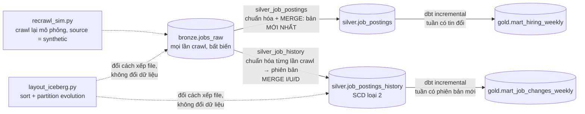

# Biến đổi dữ liệu: lịch sử tin (SCD loại 2), gold tăng dần, bố cục vật lý

Phần này trả lời góp ý của giảng viên (tháng 11): làm rõ **biến đổi dữ liệu**. Kế hoạch chọn việc:
[`ke-hoach-mo-rong.md`](ke-hoach-mo-rong.md) mục 2 (T1, T2, T6). Contract các bảng mới ở repo `joblens`:
`silver.job_postings_history` 0.1.0, `gold.mart_hiring_weekly` 0.1.0, `gold.mart_job_changes_weekly` 0.1.0.

## 1. Chuỗi biến đổi



| Biến đổi | Loại | Đầu vào → đầu ra | Kỹ thuật chính |
|---|---|---|---|
| T1 – lịch sử tin | logic (theo thời gian) | bronze (nhiều lần crawl/tin) → một dòng mỗi **phiên bản** | window `lag`/running `sum` gom trạng thái liên tiếp, `min_by`, `lead` cho `valid_to`; so khớp I/U/D; một `MERGE INTO` |
| T2 – gold tăng dần | logic (tổng hợp) | silver/history → mart theo tuần | dbt `incremental` + `delete+insert` theo `week`, chỉ tính lại tuần bị ảnh hưởng |
| T6 – bố cục | vật lý | cùng dữ liệu, xếp lại file | `rewrite_data_files` strategy `sort`; `ADD PARTITION FIELD` (partition evolution) |

## 2. T1 – `silver.job_postings_history` (SCD loại 2)

**Vấn đề:** `silver.job_postings` ghi đè bằng bản crawl mới nhất, nên mất lịch sử: không biết tin tăng lương lúc nào,
lương lúc mới đăng bao nhiêu. Bảng history giữ mọi trạng thái, mỗi trạng thái một dòng với khoảng hiệu lực.

| job_uid | version_no | valid_from | valid_to | is_current | changed_fields | salary_min_vnd |
|---|---|---|---|---|---|---|
| 3f…a1 | 1 | 2026-11-01 08:00 | 2026-11-09 08:00 | false | [] | 15.000.000 |
| 3f…a1 | 2 | 2026-11-09 08:00 | null | true | [salary_min_vnd, salary_max_vnd] | 17.000.000 |

**Thuật toán** (`spark-jobs/silver_job_history.py`):
1. Tin bị ảnh hưởng = `job_uid` có dòng bronze mới sau mốc `joblens.bronze_watermark` (thuộc tính của bảng history).
2. Đọc lại **mọi** lần crawl của các tin đó trong bronze, chuẩn hóa bằng đúng UDF của silver (`normalize.py`), tính
   `attr_hash` = sha1 của 11 cột theo dõi (tiêu đề, công ty, lương, địa điểm đã sắp xếp, cấp bậc, kinh nghiệm, hình
   thức, hạn nộp). Bản trùng chính xác (cùng tin, cùng `crawl_ts`, cùng hash) chỉ giữ một.
3. Sắp theo `(crawl_ts, kafka_offset)`; `_new = attr_hash khác lần crawl trước`; `version_no = sum(_new)` chạy dồn →
   các lần crawl liên tiếp giống nhau thành một phiên bản. `valid_to = lead(valid_from)`; `changed_fields` = cột khác
   phiên bản trước (so null-safe).
4. So với dòng hiện có **của cùng các tin** → nhãn I (thêm) / U (sửa) / D (xóa phiên bản thừa); dòng giống hệt bỏ qua.
5. Một `MERGE INTO … WHEN MATCHED AND _op='D' THEN DELETE / … 'U' THEN UPDATE / WHEN NOT MATCHED AND 'I' THEN INSERT`
   → một snapshot Iceberg; người đọc không bao giờ thấy trạng thái dở dang (ví dụ hai dòng `is_current`).

**Vì sao "tính lại theo khóa" thay vì SCD2 nối thêm thông thường** (đóng dòng cũ + thêm dòng mới theo thứ tự đến):
bronze nhận bản crawl đến trễ/sai thứ tự (replay, backfill, loại nhiễu "đến sai thứ tự" trong
[`thi-nghiem-nhieu.md`](thi-nghiem-nhieu.md)). Nối thêm theo thứ tự đến sẽ cho khoảng hiệu lực sai. Tính lại dòng thời
gian của tin từ bronze bất biến thì kết quả chỉ phụ thuộc **tập** lần crawl: chạy lại cho cùng kết quả (idempotent),
bản trễ chỉ làm sửa (U) hoặc gộp (D) phiên bản. Đây là nguyên tắc "dữ liệu thô bất biến + tính lại" của Lambda/Kappa
(bài giảng L09) áp dụng ở mức từng khóa. Kiểm thử: `tests/test_silver_job_history.py` (đến trễ cho cùng kết quả, A → B → A
là 3 phiên bản, đổi thứ tự địa điểm không phải thay đổi, chạy lại không ghi gì, bản trễ sinh U/D).

**Cái giá và giới hạn:** mỗi lần chạy quét bronze để lấy lịch sử các tin bị ảnh hưởng (bronze phân vùng theo ngày nạp,
không theo tin) – ổn ở ~10^5 dòng; lớn hơn thì cần bucket bronze theo `job_uid` hoặc giữ state theo tin. Tin đóng không
tạo phiên bản (đóng là suy luận ở silver). Kiểm tra bất biến: job tự dừng lỗi nếu số dòng `is_current` ≠ số tin; dbt test
`unique_combination`, `one_current_per_key`, `valid_intervals` trên source.

**Dữ liệu để có thay đổi:** VietJobs chỉ nạp một lần → mọi tin có đúng 1 phiên bản. `spark-jobs/recrawl_sim.py` mô phỏng
một crawler ghé lại mỗi ngày trong 28 ngày cho 2.000 tin mẫu, đôi khi nhà tuyển dụng sửa tin (tăng/giảm lương, thêm
"(Tuyển gấp)", đổi hình thức). Dữ liệu ghi rõ `source = 'synthetic'`, id `sim-…`, topic `simulation.recrawl`; cùng
`--seed` thì cùng dữ liệu; `--clean` xóa sạch. **Không** dùng làm số liệu thị trường. Để demo trực tiếp một lần sửa:
`scripts/demo-data.sh kafka` rồi `scripts/demo-data.sh update <id> "25 - 35 triệu"`.

## 3. T2 – gold tăng dần

`gold.mart_hiring_weekly` (tin mới theo tuần × nguồn × tỉnh × cấp bậc) và `gold.mart_job_changes_weekly` (tin đổi gì
theo tuần × nguồn × nhóm trường: số lần sửa, tăng/giảm lương, trung vị % đổi lương, sửa sau bao nhiêu ngày).

- `materialized='incremental'`, `incremental_strategy='delete+insert'`, `unique_key='week'`.
- Mỗi dòng lưu `updated_through` = `max(updated_ts)` của nguồn lúc dựng. Lần sau: **tuần bị ảnh hưởng** = tuần có dòng
  nguồn `updated_ts > max(updated_through)`; chỉ tính lại các tuần đó rồi xóa + chèn đúng các tuần đó.
- Tính lại cả tuần, không cộng dồn từng tin: trung vị và `count(distinct)` không cộng dồn được.
- `mart_job_changes_weekly` cần phiên bản trước (lag) có thể nằm ở tuần cũ → đọc toàn bộ lịch sử **của các tin** có thay
  đổi trong tuần bị ảnh hưởng (lọc theo `job_uid`), không đọc cả bảng.
- Dòng `location_code = 'ALL'` tính trên bảng một-dòng-một-tin (không phải trên bảng đã tách địa điểm) – nếu không, tin
  nhiều địa điểm bị đếm nhiều lần trong trung vị và tỉ lệ thỏa thuận (lỗi này có ở `mart_salary_role_region` hiện tại,
  xem mục 6).
- Giới hạn: tuần mà mọi tin bị xóa, hoặc phiên bản bị bản trễ dời sang tuần khác, giữ số cũ tới lần `--full-refresh`.

Kiểm thử không cần Trino: `tests/test_dbt_incremental.py` render model, dịch SQL Trino → DuckDB (sqlglot) và kiểm tra
**chạy tăng dần sau khi dữ liệu đổi = dựng lại toàn bộ**, chỉ tuần có thay đổi được tính lại.

## 4. T6 – bố cục vật lý (`spark-jobs/layout_iceberg.py`)

Iceberg giữ min/max từng cột cho mỗi file trong manifest; truy vấn chỉ mở file có khoảng chứa giá trị cần tìm.

1. **Sort** `bronze.jobs_raw` (phần `source = 'vietjobs'`) theo `source_job_id`, giữ số file như cũ → tra một tin mở ít
   file hơn. Truy vấn mẫu: `WHERE source_job_id = '<id cố định>'`.
2. **Partition evolution** `silver.job_postings_history`: thêm `months(valid_from)` vào `bucket(8, job_uid)` – chỉ sửa
   metadata, rồi `rewrite_data_files` đưa file cũ sang spec mới. Truy vấn mẫu: phiên bản trong 7 ngày gần nhất (kiểu gold
   tăng dần đọc).

Đo: số file, MB, **số file ứng viên** (file có [min, max] giao điều kiện – đọc từ bảng metadata `.files`) trước/sau,
trong log job và `s3://joblens/reports/layout/`; `scripts/bench-layout.sh` đo byte Trino thật sự đọc (`EXPLAIN ANALYZE`).
Lưu ý: task `iceberg_maintenance` (binpack, file đích 128 MB) sẽ gộp lại file của bronze – đo khi DAG tạm dừng; ở quy mô
lớn (nhiều file 128 MB) thì nên đổi bảo trì bronze sang strategy `sort` để giữ bố cục (ghi trong báo cáo).

## 5. Cách chạy trên cụm và dấu hiệu thành công

Chuẩn bị (một lần): áp patch, `uv sync` (cài thêm duckdb, sqlglot cho kiểm thử). Contract nằm ở PR của repo `joblens` –
cụm không cần contract để chạy; kiểm thử so contract tự bỏ qua cho tới khi PR được merge.

| # | Terminal | Lệnh | Thành công khi |
|---|---|---|---|
| 0 | T1 | `k3d cluster start joblens` rồi `kubectl get pods -A` | pod `Running`/`Completed` |
| 1 | T1 | `bash scripts/demo-mode.sh streaming` | in `==> Tắt Airflow scheduler + dag-processor` – DAG không chạy chen, có thêm ~1 GB RAM cho Spark |
| 2 | T1 | `EXECUTORS=0 DRIVER_MEMORY=2g bash deploy/spark/submit.sh recrawl_sim` | log cuối `mô phỏng 2000 tin × 28 ngày → N lần crawl ghi vào lake.bronze.jobs_raw` |
| 3 | T1 | `EXECUTORS=0 DRIVER_MEMORY=2g bash deploy/spark/submit.sh silver_job_postings` | log `MERGE … tin` (có thêm ~2.000 tin synthetic) |
| 4 | T1 | `EXECUTORS=0 DRIVER_MEMORY=2g bash deploy/spark/submit.sh silver_job_history` | log `thêm X, sửa 0, xóa 0 phiên bản` và `… tin từng thay đổi` > 0; không có `Sai bất biến` |
| 5 | T1 | chạy lại bước 4 | `không có dòng bronze mới … lịch sử giữ nguyên` (idempotent) |
| 6 | T1 | `bash scripts/bench-dbt-incremental.sh` | bảng 2 model × (full-refresh, tăng dần), trạng thái `success`; chép vào `benchmarks/incremental_gold.md` |
| 7 | T1 | `bash scripts/dbt.sh test -s source:silver.job_postings_history` | `PASS` cho cả 5 test |
| 8 | T1 | `bash scripts/bench-layout.sh` (trước) → `EXECUTORS=0 DRIVER_MEMORY=2g bash deploy/spark/submit.sh layout_iceberg` → `bash scripts/bench-layout.sh` (sau) | log job có bảng `trước`/`sau`, `candidate_files` của bronze giảm; Physical input giảm; chép vào `benchmarks/layout_iceberg.md` |
| 9 | T1 | `bash deploy/airflow/install.sh` rồi `bash scripts/demo-mode.sh airflow` | DAG mới có task `silver_job_history` giữa `silver_job_postings` và `gx_validate_silver` |

Truy vấn để xem (T2, `bash scripts/trino.sh`):

```sql
-- tin mô phỏng đổi nhiều nhất và lịch sử của nó
SELECT job_uid, count(*) AS versions FROM iceberg.silver.job_postings_history
WHERE source = 'synthetic' GROUP BY job_uid ORDER BY versions DESC LIMIT 5;
SELECT version_no, valid_from, valid_to, is_current, changed_fields, salary_min_vnd, salary_max_vnd, title
FROM iceberg.silver.job_postings_history WHERE job_uid = '<job_uid ở trên>' ORDER BY version_no;
-- time travel: lịch sử như trước lần MERGE cuối
SELECT snapshot_id, committed_at, operation, summary['added-records'] AS them, summary['deleted-records'] AS xoa
FROM iceberg.silver."job_postings_history$snapshots" ORDER BY committed_at;
SELECT * FROM iceberg.gold.mart_job_changes_weekly WHERE source = 'synthetic' ORDER BY week, changed_field;
SELECT week, location_code, level_code, new_job_count, salary_median_vnd FROM iceberg.gold.mart_hiring_weekly
WHERE source = 'synthetic' AND location_code = 'ALL' ORDER BY week;
```

Dọn dữ liệu mô phỏng: `EXECUTORS=0 bash deploy/spark/submit.sh recrawl_sim --clean`, rồi
`bash scripts/dbt.sh run -s mart_hiring_weekly mart_job_changes_weekly --full-refresh`.

## 6. Kết quả và việc còn lại

- Số đo: [`../benchmarks/incremental_gold.md`](../benchmarks/incremental_gold.md),
  [`../benchmarks/layout_iceberg.md`](../benchmarks/layout_iceberg.md) – `<cần đo>` cho tới khi chạy trên cụm.
- Phát hiện khi viết test: `gold.mart_salary_role_region` tính dòng tổng (`ALL`) bằng `grouping sets` trên bảng đã tách
  địa điểm → `job_count` đúng (đếm distinct) nhưng phân vị lương và `negotiable_share` đếm tin nhiều địa điểm nhiều lần.
  Chưa sửa (đổi số liệu đã chốt) – `<cần quyết định của nhóm>`.
- Lịch `--full-refresh` định kỳ cho hai mart tăng dần (ví dụ hằng tuần) – chưa thêm vào DAG.
