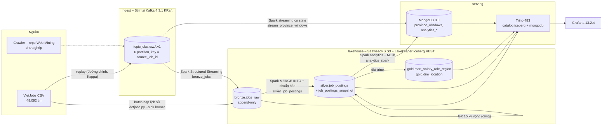
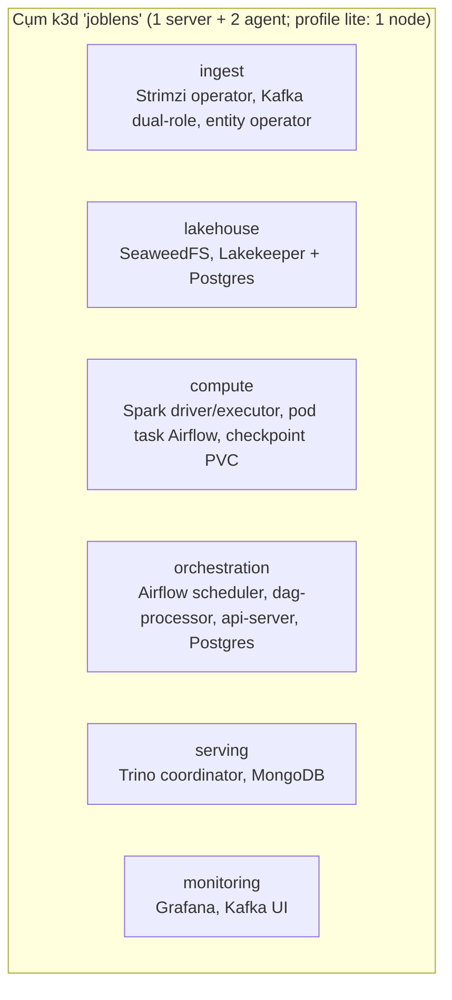

# Kiến trúc hệ thống và dữ liệu – nền tảng JobLens (IT4931)

Mô tả hệ thống **như đã dựng và chạy** trên cụm k3d (không phải bản kế hoạch). Kế hoạch gốc và lý do chọn công nghệ:
`joblens/docs/project-plan/03-nen-tang-big-data.md`; quyết định Lambda/Kappa: [`adr/0001-lambda-vs-kappa.md`](adr/0001-lambda-vs-kappa.md);
phiên bản từng lần chạy: [`../deploy/compat.md`](../deploy/compat.md). Số liệu ở đây lấy từ lần chạy ghi trong
`deploy/compat.md` – khi trình bày, đọc lại số trên Grafana hôm đó.

## 1. Bài toán

Thị trường tuyển dụng Việt Nam: mức lương theo tỉnh/thành, cấp bậc, nhóm nghề và lượng tin mới theo thời gian. Dữ
liệu đến từ nhiều nguồn tin tuyển dụng, định dạng lương/địa điểm/kinh nghiệm không thống nhất ("15 - 25 triệu",
"Thỏa thuận", "Up to $2000", "Hà Đông, Hà Nội"…). Nền tảng phải: (1) nhận tin liên tục và nạp được lịch sử,
(2) lưu thô để xử lý lại được, (3) chuẩn hóa và khử trùng theo tin, (4) kiểm tra chất lượng trước khi công bố,
(5) phục vụ truy vấn phân tích và dashboard.

## 2. Luồng dữ liệu

Điều phối: Airflow 3.3.2, DAG `joblens_pipeline` (mỗi giờ) – `silver_job_postings` → `gx_validate_silver` →
{`dbt_build_gold`, `spark_analytics` → `iceberg_maintenance`}. Task GX hỏng thì gold không được xây lại. Mỗi task là
một pod trong namespace `compute` (KubernetesPodOperator); các job Spark chạy `spark-submit` lên Kubernetes.

**Kiểu kiến trúc:** Kappa cho đường nạp (một mã `to_bronze` cho cả dữ liệu sống và replay lịch sử), batch theo lịch cho
silver/gold (cần `MERGE INTO`, dbt test, GX). Số đo lần 1 (`benchmarks/batch_vs_streaming.md`): độ trễ bronze p95
batch 122,0 s, streaming 60,6 s; hai đường cho cùng tập khóa. Chi tiết và các phương án đã cân nhắc: ADR 0001.

## 3. Triển khai trên Kubernetes

- Mọi thành phần khai báo trong `deploy/` (Helm values, manifest, `KafkaTopic` CRD); không sửa tay trên cụm.
- Bí mật (mật khẩu S3, MongoDB, Airflow) tạo bằng script cài thành Secret, không nằm trong git.
- Hai profile: `full` (máy 16 GB, WSL 12 GB) và `lite` (máy 8 GB: một node, Spark local mode, Trino/Kafka nhỏ hơn).
  Chạy trên cloud miễn phí: GitHub Codespaces – [`cloud-codespaces.md`](cloud-codespaces.md).
- Dựng từ đầu: `bash scripts/bootstrap-all.sh` (thứ tự và từng bước: [`../deploy/README.md`](../deploy/README.md)).

## 4. Dữ liệu

### 4.1. Nguồn

| Nguồn | Khối lượng | Cách vào hệ thống | Ghi chú |
|---|---|---|---|
| VietJobs (Pham Dinh et al., LREC 2026) | 48.092 tin | `deploy/data/upload-vietjobs.sh` tải CSV lên `s3://joblens/raw/vietjobs/`; nạp batch vào bronze hoặc replay vào Kafka | Trích dẫn theo giấy phép dataset; CSV không nằm trong git |
| Fixtures `joblens/fixtures/` | 3 tin | `deploy/kafka/smoke-test.sh` | Dữ liệu tự soạn, `source = synthetic` |
| Crawler TopCV/ITviec | – | Repo Web Mining ghi vào `jobs.raw.<nguồn>.v1` | Chưa ghép; nền tảng chạy độc lập không cần crawler |

Schema message `job_posting.v1` và contract các bảng nằm ở repo `joblens` (`schemas/`), repo này không giữ bản sao.

### 4.2. Các tầng lưu trữ

| Tầng | Bảng / collection | Một dòng là | Phân vùng / khóa | Ghi bởi |
|---|---|---|---|---|
| Thô | `s3://joblens/raw/vietjobs/` | file CSV gốc | – | `upload-vietjobs.sh` |
| Bronze | `iceberg.bronze.jobs_raw` | một message Kafka (giữ cả bản trùng, payload JSON nguyên trạng) | `days(ingest_ts), source`; định danh `kafka_topic, kafka_partition, kafka_offset` | `bronze_jobs.py` (streaming), `vietjobs.py --sink bronze` (batch) |
| Silver | `iceberg.silver.job_postings` | một tin (`job_uid = sha1(source:source_job_id)`), bản crawl mới nhất, đã chuẩn hóa lương VND/tháng, mã tỉnh (34 tỉnh sau 2025), kinh nghiệm, cấp bậc, loại hình | `months(first_seen_ts), bucket(16, job_uid)`; merge-on-read | `silver_job_postings.py` (MERGE INTO) |
| Silver | `iceberg.silver.job_postings_snapshot` | trạng thái một tin trong một ngày | `days(snapshot_date)` | `silver_job_postings.py` |
| Gold | `iceberg.gold.mart_salary_role_region` | tháng × nhóm nghề × cấp bậc × tỉnh (có dòng tổng `ALL`): số tin, phân vị lương, tỉ lệ thỏa thuận | `month` | dbt |
| Gold | `iceberg.gold.dim_location` | một tỉnh/thành | – | dbt seed |
| NoSQL | `mongodb.joblens.province_windows` | (cửa sổ 5 phút, tỉnh): số tin, lương trung bình | `_id = "<đầu cửa sổ>\|<mã tỉnh>"` (upsert idempotent) | `stream_province_windows.py` |
| NoSQL | `mongodb.joblens.analytics_*` | kết quả Spark: lương theo tỉnh (trung vị, trung bình cắt 10%), pivot vùng × cấp bậc, lượng nạp theo giờ, lần chạy + RMSE mô hình | ghi đè mỗi lần chạy | `analytics_spark.py` |

Chất lượng: GX 15 kỳ vọng trên silver (không trùng `job_uid`, mã trong danh mục, lương hợp lệ, ≥ 90% có địa điểm,
≥ 50% có lương) – kết quả ghi `s3://joblens/quality/gx/`; dbt test trên gold.

### 4.3. Số liệu hiện có (lần chạy 2026-10-23/24, `deploy/compat.md`)

| Chỉ số | Giá trị |
|---|---|
| Tin trong silver | 48,1K (48.092 VietJobs + tin synthetic) |
| Dòng trong bronze | 74,1K – gồm bản trùng từ các lần replay/thí nghiệm; silver khử về một dòng mỗi tin |
| Tỉ lệ có địa điểm / có lương (silver) | 98,5% / 71,5% |
| GX | 15/15 kỳ vọng đạt |
| Mô hình lương (MLlib, CrossValidator) | RMSE 10,32 triệu VND so với 11,20 của mô hình đoán trung vị |

## 5. Thao tác dữ liệu trực tiếp

`scripts/demo-data.sh` – dùng khi cần cho xem thêm/sửa/xóa dữ liệu ngay tại chỗ:

| Lệnh | Cho thấy |
|---|---|
| `sql` | Trino trên Iceberg: tạo bảng (CTAS), INSERT, UPDATE, DELETE; mỗi thao tác là một snapshot; time travel `FOR VERSION AS OF`; file Parquet trên SeaweedFS |
| `nosql` | MongoDB: insertMany (document lồng mảng), find, updateOne (`$inc`, `$push`), deleteOne, aggregate; Trino đọc collection và join với bảng Iceberg |
| `kafka "<tiêu đề>" "<lương>" "<tỉnh>"` | Một tin mới đi hết pipeline: Kafka → bronze (streaming) → silver (chuẩn hóa) – ví dụ `"20 - 30 triệu"` → 20.000.000–30.000.000 VND, `"Hà Nội"` → mã `01` |
| `clean` | Xóa mọi thứ ba lệnh trên tạo ra (bảng `sandbox`, collection `sandbox_jobs`, tin `demo-…`) |

Không theo kịch bản:

| Cách | Công cụ | Làm được |
|---|---|---|
| Terminal | `bash scripts/trino.sh` (không tham số) | Phiên Trino tương tác: mọi câu SQL trên catalog `iceberg` và `mongodb` |
| Terminal | `bash scripts/mongo.sh` | mongosh vào database `joblens` bằng user ứng dụng |
| Trình duyệt | SQLPad 7.5.7 (`deploy/data-tools/`, cổng 3001) | Soạn/chạy SQL qua Trino; Iceberg: INSERT/UPDATE/DELETE, time travel; MongoDB: INSERT/DELETE (connector không hỗ trợ UPDATE) |
| Trình duyệt | mongo-express 1.0.2 (`deploy/data-tools/`, cổng 8083) | Thêm/sửa/xóa document trong database `joblens` |
